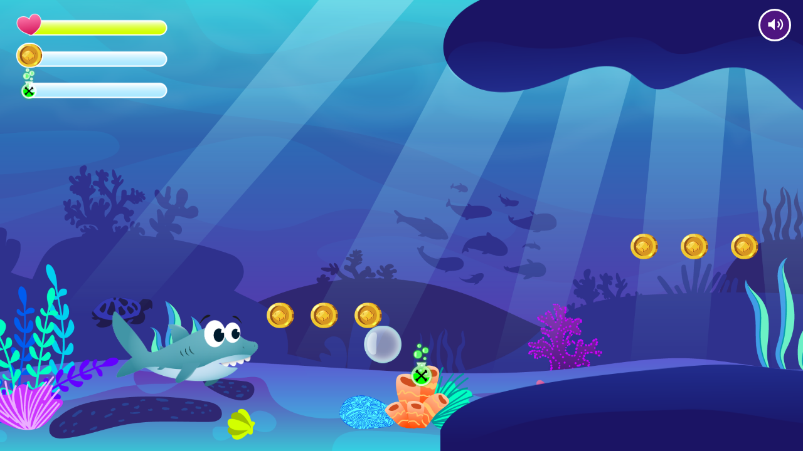
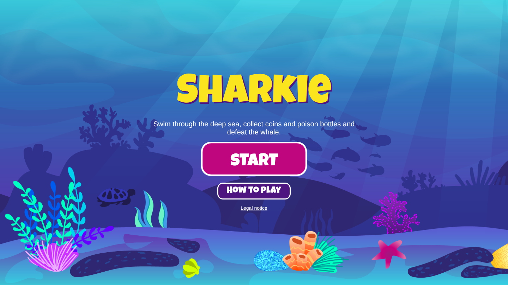
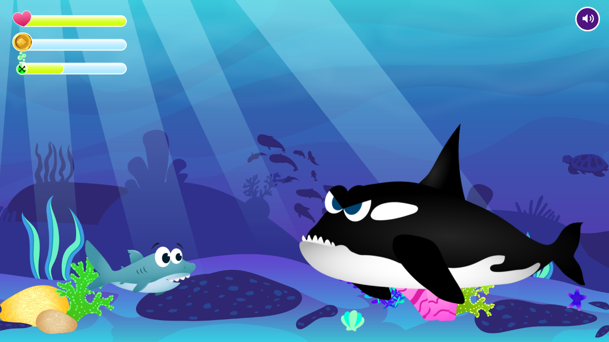
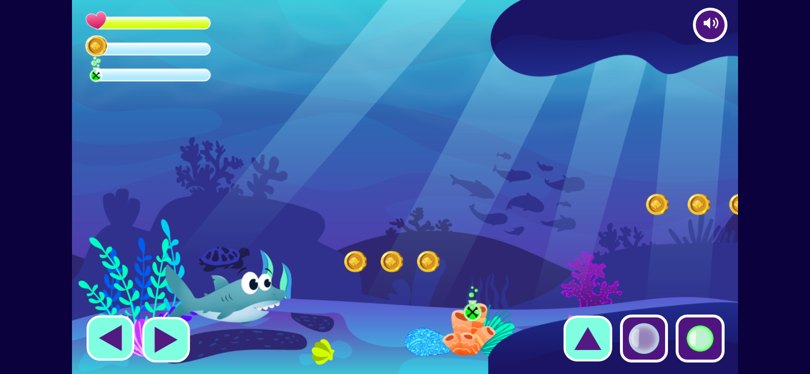

# Sharkie – 2D Underwater Jump and Run

Sharkie is a 2D jump-and-run game in the deep sea. You play a little shark who swims through a coral reef, collects coins and poison bottles, fights puffer fish and jelly fish and finally faces the big whale.
It was built as a student project at the Developer Akademie with plain HTML, CSS and JavaScript on an HTML5 canvas – object-oriented, no frameworks.



---

## Features

- **Start screen** – Landing page with a start button and a "How to play" dialog that explains the story and the keys. The dialog closes with the X or with a click next to it.
- **Smooth character animations** – Idle, swimming, attack, hurt and dead animations for Sharkie. After 10 seconds without input he falls asleep and snores.
- **Gravity and jumping** – Sharkie slowly sinks to the ground and can push himself up again with several jumps in a row.
- **Bubble attack** – Normal bubbles trap puffer fish and jelly fish. Poison bubbles use a collected poison bottle.
- **Two enemy types + end boss** – Puffer fish that inflate themselves and jelly fish that swim up and down (the green and pink ones are extra dangerous).
- **Boss fight** – At the end of the level a whale dives in from above, follows Sharkie and bites. Only poison bubbles hurt him.
- **Collectibles** – Coins and poison bottles, each with its own status bar.
- **Health system** – Sharkie loses energy when he touches an enemy and is invulnerable for a short time after each hit. When his life bar is empty, the game is lost.
- **Precise hit boxes** – Every object has its own offsets, so collisions only happen where the object is really visible.
- **Scrolling camera** – The camera follows Sharkie through a seamless background with five parallax layers.
- **Win and game over screen** – With "Try again" (restart without reloading the page) and "Home" (back to the start screen).
- **Music and sound effects** – Background music, bubbles, snoring, trapped enemies, the whale's splash and bite, win and game over sounds. A mute button turns everything off, and the choice is saved in the local storage.
- **Mobile controls** – Touch buttons on phones and tablets. They only show up on touch devices and small screens, and the context menu is turned off.
- **Responsive** – The canvas scales with the screen and keeps its 16:9 format. In portrait mode a hint asks you to turn your device.
- **Fast start** – All images are loaded once while the start screen is shown, so the game starts without waiting.
- **Legal notice** – Separate page with the provider information and the terms of use.

---

## Controls

| Key | Action |
|-----|--------|
| ← / → | Swim left / right |
| Space or ↑ | Jump / swim up |
| D | Shoot a bubble |
| F | Shoot a poison bubble (needs a poison bottle) |

On phones and tablets the same actions are on the touch buttons.

| Start screen | Boss fight |
|---|---|
|  |  |



---

## Tech Stack

- HTML5 Canvas
- CSS3
- JavaScript (Vanilla, ES6 classes)

---

## Getting Started

1. Clone the repository:
```bash
   git clone https://github.com/Oeztuerk1992/sharkie.git
```
2. Open the project folder in VS Code.
3. Start **Live Server** from the project root folder.
4. Open `index.html` and start playing.

---

## Project Structure

```
index.html            Start page with the game canvas
impressum.html        Legal notice
script.js             Starts, ends and restarts the game, start screen and dialog
sound.js              Music, sound effects and the mute button
controls.js           Keyboard and touch buttons
style.css             Layout of the page
classes/              One file per class (World, Character, enemies, status bars, ...)
levels/               Level data – where enemies, barriers, coins and bottles are placed
templates/            Functions that return HTML templates
img/                  All graphics (Sharkie, enemies, background, status bars, buttons)
fonts/                Local font files
sounds/               Music and sound effects
```

### Class overview

```
DrawableObject                Everything that is drawn on the canvas
├── BackgroundObject          One background layer
├── Barrier                   Rocks and reefs
├── StatusBar                 Life, coin and poison bar
└── MovableObject             Everything that moves, gets hit or is animated
    ├── Character             Sharkie
    ├── PufferFish            Enemy type 1
    ├── JellyFish             Enemy type 2
    ├── EndBoss               The whale
    ├── ThrowableObject       Bubble and poison bubble
    ├── Coin
    └── PoisonBottle

World                         Draws everything, moves the camera and checks collisions
Level                         Holds all objects of one level
Keyboard                      Remembers which keys are pressed
```

---

## Clean Code

- Max. 14 lines per function, one task per function
- Max. 400 lines per file
- Every function documented with [JSDoc](https://jsdoc.app/about-getting-started.html)
- camelCase names in English
- No `console.log` and no console errors

---

## Author

| Name | GitHub |
|------|--------|
| Sinan Öztürk | [@Oeztuerk1992](https://github.com/Oeztuerk1992) |

---

## Credits

- Graphics: provided by the [Developer Akademie](https://developerakademie.com/)
- Music and sound effects: [Pixabay](https://pixabay.com/) (Pixabay Content License)
- Font: [Luckiest Guy](https://fonts.google.com/specimen/Luckiest+Guy) (Apache License 2.0)
- Snore sound: "Cartoon Whistle Snore" by [BudgetPixel AI](https://budgetpixel.com/sfx/cartoon-whistle-snore-f5c02db6) (CC BY 4.0)
